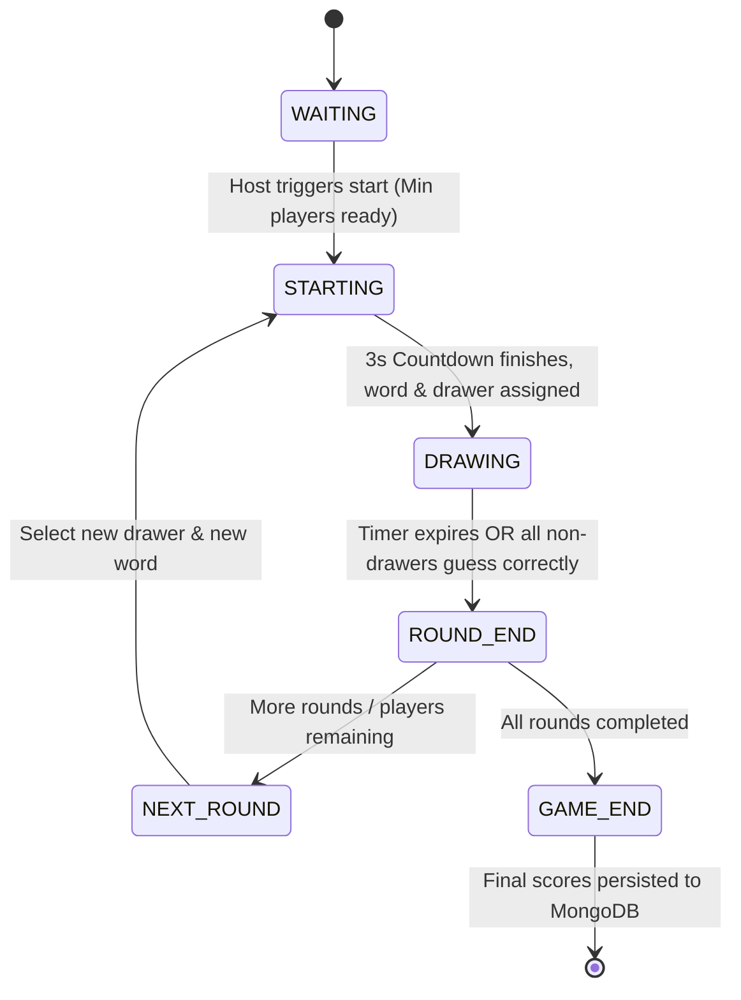

# Draw or Die 🎨💀

A high-performance, real-time multiplayer drawing and guessing game built with the **MERN** stack (**M**ongoDB, **E**xpress, **R**eact, **N**ode.js), **Socket.IO**, and the **HTML5 Canvas API**.

> Designed based on a server-authoritative architecture to ensure anti-cheat integrity, low-latency stroke synchronization, and robust disconnection recovery.

---

## 📋 Table of Contents

- [Overview & Architecture](#-overview--architecture)
  - [Dual Communication Planes](#dual-communication-planes)
  - [Architecture Diagram](#architecture-diagram)
  - [In-Memory State vs. Persistent Storage](#in-memory-state-vs-persistent-storage)
- [✨ Key Features](#-key-features)
- [🛠️ Tech Stack](#️-tech-stack)
- [📁 Project Folder Structure](#-project-folder-structure)
- [🔄 Game Engine & State Machine](#-game-engine--state-machine)
- [📡 Socket.IO Event Contract](#-socketio-event-contract)
- [💾 Database Design & Schemas](#-database-design--schemas)
- [🚀 Quick Start \& Local Development](#-quick-start--local-development)
  - [Prerequisites](#prerequisites)
  - [1. Backend Setup](#1-backend-setup)
  - [2. Frontend Setup](#2-frontend-setup)
- [🔑 Environment Variables](#-environment-variables)
- [🗺️ Engineering Roadmap \& Milestones](#️-engineering-roadmap--milestones)
- [🛡️ Anti-Cheat \& Security Measures](#️-anti-cheat--security-measures)
- [🌐 Deployment Architecture](#-deployment-architecture)

---

## 📐 Overview & Architecture

### Dual Communication Planes

`Draw or Die` separates concerns between two parallel communication channels:

1. **REST API (HTTPS)**: Handles long-lived, stateful operations across user sessions (Authentication, User Profiles, Match History queries).
2. **Socket.IO (WSS)**: Handles ephemeral, real-time, per-room events requiring sub-second latency (Player presence, live canvas stroke streaming, chat/guesses, synchronized timers, turn transitions).

| Concern | REST API | Socket.IO | Rationale |
| :--- | :---: | :---: | :--- |
| **Register / Login** | **Yes** | No | One-shot DB write, password hashing, JWT issue. |
| **User Stats & Profile** | **Yes** | No | Point-in-time read, cacheable. |
| **Persistent Match History** | **Yes** | No | Written once at game completion, queried on demand. |
| **Create / Join Rooms** | Optional | **Yes** | Room code creation via REST or Socket; live room presence via WebSockets. |
| **Player Joined / Left** | No | **Yes** | Immediate room broadcast required. |
| **Drawing Stroke Stream** | No | **Yes** | High frequency, ultra-low latency canvas vector transmission. |
| **Chat & Guesses** | No | **Yes** | Instant broadcast & server-authoritative guess validation. |
| **Timer Ticks & Turns** | No | **Yes** | Synced clock ticks and automated turn rotation. |

### Architecture Diagram

```
                 ┌────────────────────────────────┐
                 │          React Client          │
                 │  (Vite, React Router, Canvas)  │
                 └───────────────┬────────────────┘
                                 │
            ┌────────────────────┴────────────────────┐
            │                                         │
       HTTPS (REST API)                         WSS (Socket.IO)
            │                                         │
            ▼                                         ▼
  ┌───────────────────┐    shared HTTP    ┌──────────────────────┐
  ┌ Express REST API  │◄─────────────────►│   Socket.IO Server   │
  │ /auth, /history   │    Node Process   │  (Events & Dispatch) │
  └─────────┬─────────┘                   └──────────┬───────────┘
            │                                        │
     Mongoose (ODM)                              In-Memory
            │                                        │
            ▼                                        ▼
  ┌───────────────────┐                   ┌──────────────────────┐
  │     MongoDB       │                   │  Game State Manager  │
  │  (Users, History) │                   │ (Rooms, Timers, RAM) │
  └───────────────────┘                   └──────────────────────┘
```

### In-Memory State vs. Persistent Storage

- **In-Memory (RAM on Server)**: Active room states, connected sockets, player scores for ongoing matches, current drawer ID, secret word, round timers, and stroke history. Avoids hundreds of database writes per minute.
- **MongoDB (Database)**: User credentials, aggregate player lifetime stats (`gamesPlayed`, `gamesWon`, `totalScore`), persistent match summaries (`GameHistory`), and word banks.

---

## ✨ Key Features

- **⚡ Vector-Based Canvas Synchronization**: Transmits coordinate stroke delta arrays (`{ x, y, color, brushSize, type }`) instead of heavy image snapshots, throttled via `requestAnimationFrame` for seamless rendering.
- **🛡️ Server-Authoritative Anti-Cheat**: All game decisions (word picking, guess validation, score calculations, turn timers, drawer eligibility) are evaluated exclusively on the server.
- **🔐 JWT Authentication Over WebSockets**: Authenticated Socket.IO handshake using JWT tokens attached at connection initialization.
- **⏱️ Synced Game Engine State Machine**: Automated state transitions (`WAITING` ➔ `STARTING` ➔ `DRAWING` ➔ `ROUND_END` ➔ `NEXT_ROUND` ➔ `GAME_END`).
- **💬 Real-Time Chat & Answer Concealment**: Automatically hides the secret word in public chat when guessed correctly, awarding dynamic time-based scores.
- **🔄 Graceful Reconnection Handling**: 25-second grace window for unexpected player disconnects/refreshes before removing slots or re-assigning hosts.

---

## 🛠️ Tech Stack

### Frontend
- **Framework**: React 19 (Vite build tool)
- **Routing**: React Router
- **Graphics**: HTML5 Canvas API (2D Context)
- **Real-Time Client**: `socket.io-client`
- **State Management**: React Context API (`AuthContext`, `SocketContext`, `GameContext`)
- **HTTP Client**: Axios

### Backend
- **Runtime**: Node.js
- **Web Framework**: Express.js (v5)
- **WebSocket Protocol**: Socket.IO (v4)
- **Database / ODM**: MongoDB Atlas & Mongoose
- **Auth & Security**: JSON Web Tokens (`jsonwebtoken`), `bcrypt`, `cookie-parser`
- **Configuration**: `dotenv`, `cors`

---

## 📁 Project Folder Structure

This repository is organized as a monorepo containing both the `/Backend` and `/Frontend` source trees:

```
Draw-or-Die/
├── Backend/
│   ├── src/
│   │   ├── config/          # Database & Environment configs (db.js, config.js)
│   │   ├── controllers/     # Auth & History REST route handlers
│   │   ├── game/            # Pure game domain logic
│   │   │   ├── GameStateManager.js  # Game state machine & round management
│   │   │   ├── RoomManager.js       # In-memory room store (RAM)
│   │   │   ├── scoring.js           # Time & guess score calculations
│   │   │   └── wordBank.js          # Secret word list & randomizer
│   │   ├── middlewares/     # JWT Auth & Error Handling middleware
│   │   ├── models/          # Mongoose Schemas (User.model.js, GameHistory.model.js)
│   │   ├── routes/          # Express REST endpoints (/api/auth, /api/history)
│   │   ├── sockets/         # Socket event domain handlers
│   │   │   ├── index.js          # Socket init & auth handshake middleware
│   │   │   ├── roomHandlers.js   # Create/Join/Leave room socket handlers
│   │   │   ├── gameHandlers.js   # Start game, ready states, turn changes
│   │   │   ├── drawHandlers.js   # Canvas stroke relay
│   │   │   └── chatHandlers.js   # Chat messages & guess validation
│   │   └── utils/           # Helper utilities
│   ├── app.js               # Express application configuration
│   ├── server.js            # Combined HTTP & Socket.IO server entrypoint
│   └── package.json
│
├── Frontend/
│   ├── src/
│   │   ├── components/
│   │   │   ├── canvas/      # DrawingCanvas.jsx, Toolbar.jsx
│   │   │   ├── chat/        # ChatBox.jsx, GuessInput.jsx
│   │   │   ├── game/        # ScoreBoard.jsx, TurnIndicator.jsx, Timer.jsx
│   │   │   └── room/        # PlayerList.jsx, RoomCodeDisplay.jsx
│   │   ├── context/         # AuthContext.jsx, SocketContext.jsx, GameContext.jsx
│   │   ├── hooks/           # useSocket.js, useCanvas.js, useTimer.js
│   │   ├── pages/           # LoginPage, LobbyPage, RoomPage, GamePage, ResultsPage
│   │   ├── routes/          # ProtectedRoute.jsx, App router
│   │   ├── services/        # Axios API client setup (api.js)
│   │   ├── sockets/         # Centralized socket event name constants
│   │   ├── App.jsx
│   │   └── main.jsx
│   ├── index.html
│   ├── vite.config.js
│   └── package.json
│
└── README.md
```

---

## 🔄 Game Engine & State Machine

The game progress follows a deterministic, server-managed state machine:



---

## 📡 Socket.IO Event Contract

### Client ➔ Server Events

| Event Name | Payload Shape | Server Logic |
| :--- | :--- | :--- |
| `create_room` | `{}` | Generates unique room code, initializes RAM room, assigns sender as host. |
| `join_room` | `{ roomCode }` | Validates room availability; joins socket room; broadcasts `player_joined`. |
| `leave_room` | `{}` | Removes player; reassigns host if needed; broadcasts `player_left`. |
| `set_ready` | `{ ready: boolean }` | Updates player ready state in memory. |
| `start_game` | `{}` | Verifies host authority and ready conditions; transitions to `STARTING`. |
| `draw` | `{ x, y, color, brushSize, type }` | Verifies sender is active drawer; broadcasts stroke to room clients. |
| `clear_canvas` | `{}` | Verifies active drawer; emits `clear_canvas` to room. |
| `send_message` | `{ text }` | Validates text length; forwards to guess handler if sender is not drawer. |
| `submit_guess` | `{ text }` | Compares case-insensitive string to secret word; awards points if correct. |

### Server ➔ Client Events

| Event Name | Payload Shape | Client Action |
| :--- | :--- | :--- |
| `player_joined` | `{ players: [...] }` | Updates player list UI. |
| `game_starting` | `{ countdown }` | Displays pre-game countdown screen. |
| `turn_changed` | `{ drawerId, wordLength }` | Updates turn UI; reveals secret word **only** to the drawer. |
| `draw_update` | `{ x, y, color, brushSize, type }` | Draws line segment onto receiving canvas context. |
| `correct_guess` | `{ userId, username, points }` | Shows success system message and updates scoreboard. |
| `timer_update` | `{ secondsRemaining }` | Updates round timer component. |
| `round_ended` | `{ word, scores }` | Reveals secret word and round score breakdown. |
| `game_ended` | `{ finalScores }` | Displays overall match winner and updates stats. |

---

## 💾 Database Design & Schemas

### 1. User Schema (`User.model.js`)
```javascript
const userSchema = new Schema({
  username:     { type: String, required: true, unique: true },
  passwordHash: { type: String, required: true },
  createdAt:    { type: Date, default: Date.now },
  stats: {
    gamesPlayed: { type: Number, default: 0 },
    gamesWon:    { type: Number, default: 0 },
    totalScore:  { type: Number, default: 0 }
  }
});
```

### 2. Game History Schema (`GameHistory.model.js`)
```javascript
const gameHistorySchema = new Schema({
  roomCode: String,
  players: [{
    userId:          { type: Schema.Types.ObjectId, ref: 'User' },
    username:        String,
    finalScore:      Number,
    correctGuesses:  Number
  }],
  rounds: Number,
  startedAt: Date,
  endedAt: Date
});
```

---

## 🚀 Quick Start & Local Development

### Prerequisites

- **Node.js**: `v18.x` or higher
- **npm**: `v9.x` or higher
- **MongoDB**: Local instance running on port `27017` or a MongoDB Atlas connection string.

---

### 1. Backend Setup

```bash
# Navigate to Backend directory
cd Backend

# Install dependencies
npm install

# Create environment file
cp .env.example .env  # or edit .env directly

# Start development server with nodemon
npm run dev
```

*Backend runs by default on `http://localhost:3000`.*

---

### 2. Frontend Setup

```bash
# Open a new terminal and navigate to Frontend directory
cd Frontend

# Install dependencies
npm install

# Start Vite development server
npm run dev
```

*Frontend dev server runs by default on `http://localhost:5173`.*

---

## 🔑 Environment Variables

### Backend (`Backend/.env`)

```env
PORT=3000
MONGO_URI=mongodb://localhost:27017/draw-or-die
JWT_SECRET=your_super_secret_jwt_key_change_in_production
CORS_ORIGIN=http://localhost:5173
```

### Frontend (`Frontend/.env`)

```env
VITE_API_URL=http://localhost:3000/api
VITE_SOCKET_URL=http://localhost:3000
```

---

## 🗺️ Engineering Roadmap & Milestones

The project was structured across an 11-milestone development timeline:

| Milestone | Title | Key Features Delivered |
| :---: | :--- | :--- |
| **M0** | Project Setup | Repository monorepo structure, Node/Express/Vite tooling, environment configs. |
| **M1** | Auth Foundation | REST Registration/Login endpoints, bcrypt hashing, JWT issuance. |
| **M2** | Socket Foundation | Socket.IO attachment, JWT auth middleware handshake verification. |
| **M3** | Room System | Room creation/joining, socket room grouping (`socket.join`), RAM room store. |
| **M4** | Lobby System | Ready state toggle, host-only permission control for starting games. |
| **M5** | Canvas MVP | Client-side solo drawing tools (brush size, palette, eraser, clear). |
| **M6** | Real-Time Sync | Canvas stroke vector streaming, live chat, exact match guess checking. |
| **M7** | Core Game Engine | Server state machine, automated turn rotations, word picking, scoring engine. |
| **M8** | Timer & Reconnection | Server countdown timer, 25s grace-period disconnect & host reassignment logic. |
| **M9** | History & Testing | `GameHistory` MongoDB persistence, Jest unit tests for game logic. |
| **M10** | Deployment | Production deployment on Render/Railway (Backend) & Vercel (Frontend). |
| **M11** | Polish & AI | UI/UX responsive polish, optional LLM dynamic word category generation. |

---

## 🛡️ Anti-Cheat & Security Measures

1. **JWT Auth Handshake**: Socket identity is attached server-side (`socket.userId = decoded.userId`) upon initial WebSocket connection. Payloads containing modified user IDs are ignored.
2. **Hidden Secret Word**: The secret word is **only** emitted directly to the drawer's socket (`socket.emit`). Guesses are sent as raw text and validated server-side, preventing client memory inspection.
3. **Role Validation**: Canvas draw and clear events verify that `socket.id === room.drawerSocketId` before broadcasting. Non-drawer strokes are dropped.
4. **Host Permission Checks**: Server validates host identity before executing state changes like `start_game`.

---

## 🌐 Deployment Architecture

- **Frontend Hosting**: Vercel / Netlify (Static SPA build with CDN caching).
- **Backend Hosting**: Render / Railway (Persistent Node process supporting WebSocket upgrades and HTTP connections).
- **Database**: MongoDB Atlas Managed Cluster.

> ⚠️ **Deployment Note**: Socket.IO requires persistent connections. Avoid serverless functions (like standard Vercel API routes) for the backend Node server process. Ensure CORS origins match the production domain.

---

## 📜 License

This project is licensed under the [ISC License](LICENSE).
